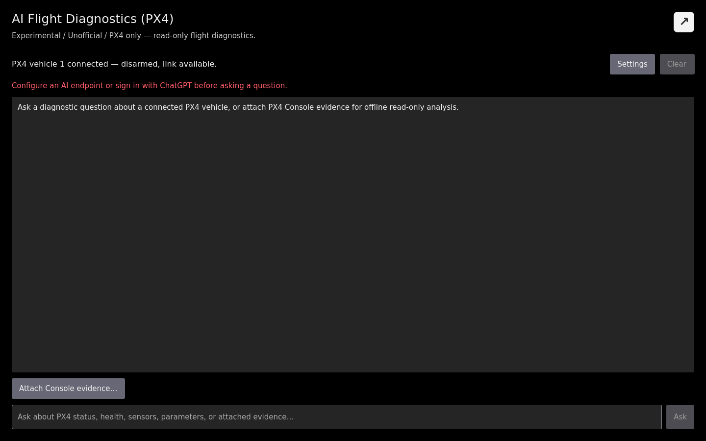

# Update: Moving the Safety-Bounded PX4 AI Assistant to QGroundControl Analyze View

> **Experimental / Unofficial / PX4 only:** This update describes work on a development branch. It is not an upstream QGroundControl feature or a flight-safety authority.

This is a detailed follow-up to [Building a Safety-Bounded AI Flight Diagnostic Assistant in QGroundControl](https://discuss.px4.io/t/building-a-safety-bounded-ai-flight-diagnostic-assistant-in-qgroundcontrol/49228). The original post remains available as a record of the MAVLink Console prototype.

## Why the direction changed

A QGroundControl maintainer commented that the concept looked interesting, but that it did not belong inside MAVLink Console. The important point was architectural: MAVLink Console is PX4-only, while a QGroundControl feature should have a clearer product boundary. The suggested direction was a dedicated Analyze page.

The current branch now implements that direction:

- The assistant is a dedicated **AI Flight Diagnostics (PX4)** page under Analyze Tools.
- MAVLink Console is again a standalone Console tool.
- Common conversation and context handling are separated from firmware-specific diagnostics.
- Phase one deliberately registers only a PX4 provider; it does not claim ArduPilot support.

## New Analyze experience

The new page presents the connected firmware, armed/flight state, link state, and available diagnostic data. It contains the conversation, question input, Ask, Cancel, Clear, Settings, and a local approval card for gated MAVLink data requests.

PX4 Console text is now optional evidence, not an implicit data source. A collapsed attachment area accepts text only when the user deliberately pastes it. The page explains that the attachment will be sent to the selected AI service, sends only the final 12,000 characters, and clears the attachment when the session is cleared or the active Vehicle changes.

The request boundary is explicit for each connection state:

| State | Can ask? | Local Vehicle tools |
| --- | --- | --- |
| Supported PX4 Vehicle connected | Yes, when an AI service is configured | Available under the local safety policy |
| Non-PX4 Vehicle connected | No; rejected before any AI request | Disabled |
| No Vehicle, no attachment | No | Disabled |
| No Vehicle, explicit attachment | Yes, for attachment-only analysis | Disabled |

## Refactored architecture and context contract

The original Console-oriented controller has been split into four responsibilities:

- **AIDiagnosticController** coordinates the QML conversation, request lifecycle, cancellation, approval, service selection, and local tool execution.
- **AIDiagnosticContextBuilder** creates a versioned QGroundControl snapshot containing core Vehicle state, sensor summaries, health and arming checks, link state, FactGroups, batteries, provider evidence, and the explicit Console attachment.
- **AIDiagnosticProvider** defines the firmware-diagnostic extension boundary.
- **PX4DiagnosticProvider** implements PX4 eligibility, external-vision evidence, parameter and Console policies, question routing, the MAVLink data-message whitelist, and PX4-specific prompt semantics.

The context contract starts at `schemaVersion: 1`. Missing evidence is represented as unavailable or unknown instead of being turned into a guessed fault. Future context changes can therefore be reviewed as changes to an explicit interface rather than as untracked prompt text.

## Two AI service paths and the data boundary

The two service paths remain intentionally different:

1. **OpenAI-compatible Chat Completions:** QGroundControl sends the versioned context and a fixed structured-tool registry. A model may propose a tool call, but QGroundControl validates the tool name, arguments, bound Vehicle, state, whitelist, and call limits locally.
2. **ChatGPT through the local Codex App Server:** QGroundControl sends the supplied context and receives answer text. This path is started read-only and does not expose QGroundControl local tools or approval actions.

Depending on availability, the versioned context may contain Vehicle identity and firmware, armed and flight state, mode and readiness, position, sensor and battery summaries, health/arming checks, link counters, FactGroups, relevant loaded PX4 parameters, provider-generated evidence, limited conversation history, and Console text explicitly attached by the user.

This does not remove the remote service's own data-handling terms. Users should still remove secrets, identifiers, internal addresses, and unrelated Console output before sending a request.

## Safety boundary retained and tightened

The assistant cannot arm, disarm, move, take off, land, change modes, write or reset parameters, calibrate, reboot, run actuator tests, edit missions, or execute arbitrary shell or MAVLink commands.

The OpenAI-compatible path exposes only a fixed diagnostic registry:

- Current QGroundControl state, FactGroups, health, link status, and loaded-parameter reads are in-memory and read-only.
- Restricted PX4 Console diagnostics use a command whitelist and a per-question call limit.
- `MAV_CMD_REQUEST_MESSAGE` and temporary `MAV_CMD_SET_MESSAGE_INTERVAL` are limited to whitelisted telemetry messages and always require explicit user approval.

Vehicle-side Console and MAVLink requests are rejected when the PX4 Vehicle is armed, flying, or communication is lost. Each request is bound to the Vehicle that was active when it started. Switching, disconnecting, or destroying that Vehicle cancels the request and clears pending approval, preventing a delayed result or approval from being applied to another Vehicle.

## Settings compatibility

The settings interface is now named `AIAssistantSettings`, and QML uses `aiAssistantSettings`. A temporary `aiConsoleSettings` alias remains for compatibility. The underlying QSettings group is still `AIConsole`, preserving the endpoint, model, API key, ChatGPT model selection, and legacy fields from the earlier prototype.

## Source and build availability

- Source branch: [ai/mavlink-console-assistant-v5.0.8](https://github.com/amovlgf/qgroundcontrol/tree/ai/mavlink-console-assistant-v5.0.8)
- Analyze-view feature commit: [`823585e0e02aca598f7f8c35bbb9a6161aeab766`](https://github.com/amovlgf/qgroundcontrol/commit/823585e0e02aca598f7f8c35bbb9a6161aeab766)
- Current branch HEAD: [`5f869595db94f35c0a30bfdd5a1cb211a91e4fcd`](https://github.com/amovlgf/qgroundcontrol/commit/5f869595db94f35c0a30bfdd5a1cb211a91e4fcd), a later Linux launcher input-method fix that does not change the AI diagnostic architecture.

There is currently **no prebuilt experimental package containing the Analyze-view implementation**. The existing [`v5.0.8.1-ai.1`](https://github.com/amovlgf/qgroundcontrol/releases/tag/v5.0.8.1-ai.1) package was built from [`e561057133ffeb9d735710758c11fb6320ffbe09`](https://github.com/amovlgf/qgroundcontrol/commit/e561057133ffeb9d735710758c11fb6320ffbe09) and contains the older MAVLink Console prototype. It should not be used to evaluate the new Analyze page.

## Verification status

The Analyze-view change adds automated coverage for:

- The dedicated Analyze page, AI settings page, and standalone MAVLink Console page
- Versioned attachment-only context
- Legacy settings storage and the compatibility alias
- PX4 versus non-PX4 provider eligibility
- Parameter-name, Console-command, and MAVLink-message whitelists
- External-vision routing and confirmed, invalid, unavailable, and unknown evidence semantics
- Vehicle switching and stale asynchronous-event isolation
- Codex App Server client protocol behavior

The bilingual VitePress documentation build has been rerun successfully for this update. PX4 SITL is the intended manual acceptance environment for status, parameters, external vision, approval, cancellation, Vehicle switching, armed/flying state, communication loss, and attachment-only analysis. A compatible application runtime still needs to rerun the focused unit tests, Debug build, and the full SITL matrix before a new binary is offered. This update therefore describes the implemented coverage without claiming a newly verified release.

## Scope and questions for the community

ArduPilot is intentionally outside phase one. The provider boundary leaves room for a separately designed implementation, but adding a firmware label without equivalent evidence semantics, safety checks, ownership, and tests would not be meaningful support.

The feedback that would be most useful now is:

1. Does the dedicated Analyze-page layout provide the right balance between conversation and structured Vehicle health?
2. Is the boundary between common QGroundControl context and PX4-specific provider evidence clear enough?
3. Is a versioned context contract a useful basis for reviewing what data can be sent to an AI service?
4. Are the explicit attachment and data-boundary notices sufficient, or should a request preview and redaction step come first?
5. Which additional PX4 diagnostic scenario has evidence semantics clear enough to implement and test next?

Feedback on the Analyze workflow, provider abstraction, data contract, privacy boundary, and local safety policy would be very helpful.
