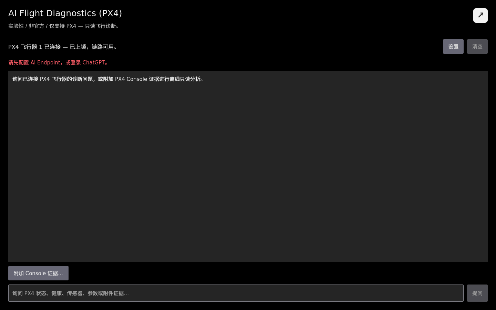
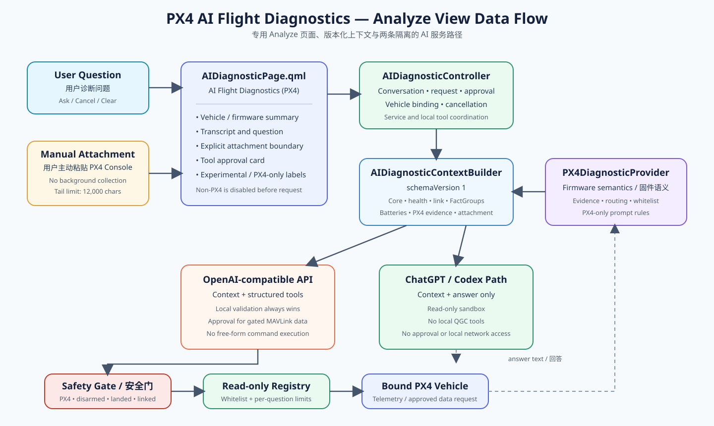
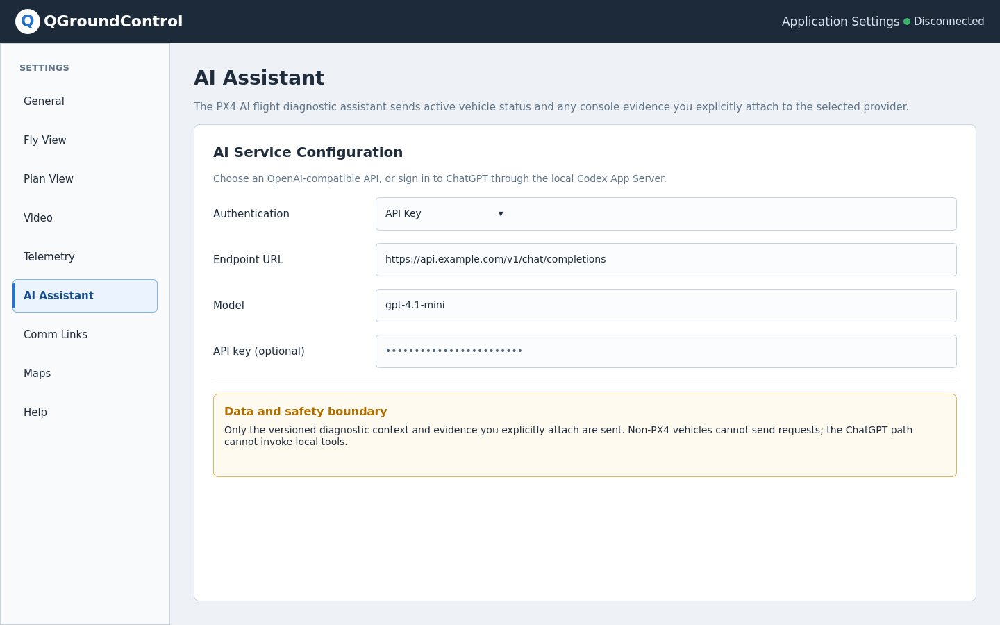
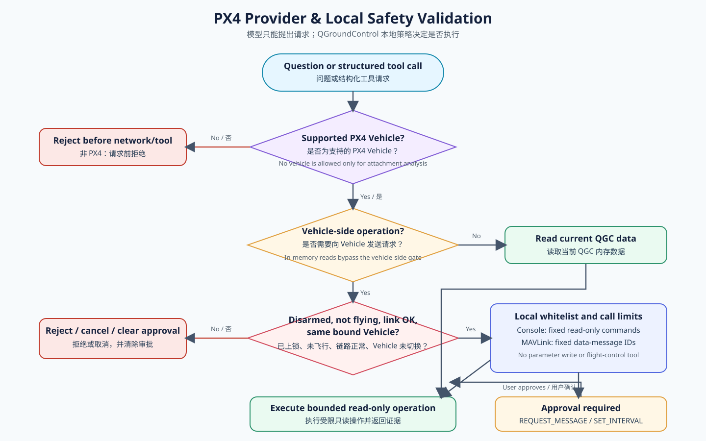

# 更新：将受安全边界约束的 PX4 AI 助手迁入 QGroundControl Analyze 页面

> **实验性 / 非官方 / 仅支持 PX4：** 本文介绍开发分支中的实验性实现。它不是 QGroundControl 上游正式功能，也不能作为飞行安全判断依据。

本文是论坛文章 [Building a Safety-Bounded AI Flight Diagnostic Assistant in QGroundControl](https://discuss.px4.io/t/building-a-safety-bounded-ai-flight-diagnostic-assistant-in-qgroundcontrol/49228) 的详细后续更新。原文继续保留，作为早期 MAVLink Console 原型的历史记录。

## 为什么调整方向

QGroundControl 维护者在评论中认为这个概念有意思，但指出它不适合放在 MAVLink Console 中。关键问题是产品与架构边界：MAVLink Console 本身只支持 PX4，而 QGroundControl 功能应有更清晰的独立入口；维护者建议为它建立新的 Analyze 页面。

当前分支已经落实这一方向：

- 助手迁移到 Analyze Tools 下独立的 **AI Flight Diagnostics (PX4)** 页面。
- MAVLink Console 恢复为独立 Console 工具。
- 通用对话和上下文处理与固件专属诊断分离。
- 第一阶段有意只注册 PX4 Provider，不宣称支持 ArduPilot。

## 新 Analyze 页面

新页面显示当前固件、解锁/飞行状态、链路状态和可用诊断数据，同时提供对话、提问、取消、清空、设置，以及针对受限 MAVLink 数据请求的本地审批卡片。

PX4 Console 文本现在是可选证据，而不是隐式数据来源。默认折叠的附件区域只接收用户主动粘贴的文本；页面明确说明附件会发送给所选 AI 服务，只发送末尾 12,000 个字符，并在清空会话或切换活动 Vehicle 时同步清除。

不同连接状态下的请求边界如下：

| 状态 | 是否可提问 | 本地 Vehicle 工具 |
| --- | --- | --- |
| 已连接受支持的 PX4 Vehicle | AI 服务已配置时允许 | 按本地安全策略提供 |
| 已连接非 PX4 Vehicle | 禁止；在发起 AI 请求前拒绝 | 禁用 |
| 无 Vehicle、无附件 | 禁止 | 禁用 |
| 无 Vehicle、有显式附件 | 允许仅附件分析 | 禁用 |

## 重构后的架构与上下文契约

原先面向 Console 的控制器被拆分为四类职责：

- **AIDiagnosticController**：协调面向 QML 的对话、请求生命周期、取消、审批、服务选择和本地工具执行。
- **AIDiagnosticContextBuilder**：创建版本化 QGroundControl 快照，包括 Vehicle 核心状态、传感器摘要、健康与解锁检查、链路、FactGroup、电池、Provider 证据和显式 Console 附件。
- **AIDiagnosticProvider**：定义固件诊断扩展边界。
- **PX4DiagnosticProvider**：实现 PX4 支持判断、外部视觉证据、参数与 Console 策略、问题路由、MAVLink 数据消息白名单和 PX4 专属 Prompt 语义。

上下文契约从 `schemaVersion: 1` 开始。缺失证据会被标记为 unavailable 或 unknown，而不会被推断为故障；后续上下文变化也可以作为显式接口变更进行审查，而不是隐藏在 Prompt 文本中。

## 两种 AI 服务路径与数据边界

两条服务路径有意保持不同能力：

1. **OpenAI-compatible Chat Completions：** QGroundControl 发送版本化上下文和固定的结构化工具注册表。模型可以提出工具调用，但工具名称、参数、绑定 Vehicle、状态、白名单和调用次数都由 QGroundControl 在本地校验。
2. **通过本地 Codex App Server 使用 ChatGPT：** QGroundControl 发送已提供的上下文并接收文本回答。该路径以只读方式启动，不暴露 QGroundControl 本地工具或审批操作。

根据可用情况，版本化上下文可能包括 Vehicle 身份与固件、解锁和飞行状态、模式与就绪状态、位置、传感器和电池摘要、健康/解锁检查、链路计数、FactGroup、相关已加载 PX4 参数、Provider 生成的证据、有限对话历史，以及用户主动附加的 Console 文本。

这并不会取代远端服务自身的数据处理条款。发送请求前，用户仍应移除密钥、标识符、内部地址和无关 Console 输出。

## 保留并加强安全边界

助手不能解锁、上锁、移动、起飞、降落、切换模式、写入或重置参数、校准、重启、运行执行器测试、修改任务，也不能执行任意 Shell 或 MAVLink 命令。

OpenAI-compatible 路径只暴露固定诊断工具注册表：

- 当前 QGroundControl 状态、FactGroup、健康、链路状态和已加载参数均为内存只读查询。
- 受限 PX4 Console 诊断使用命令白名单和单问题调用次数限制。
- `MAV_CMD_REQUEST_MESSAGE` 和临时 `MAV_CMD_SET_MESSAGE_INTERVAL` 只能请求白名单内的遥测消息，并始终要求用户明确确认。

PX4 Vehicle 已解锁、正在飞行或通信丢失时，Vehicle 侧 Console/MAVLink 请求会被拒绝。每次请求都绑定开始时的活动 Vehicle；切换、断开或销毁该 Vehicle 会取消请求并清除待审批操作，避免迟到结果或审批被应用到另一个 Vehicle。

## 设置兼容

设置接口现已更名为 `AIAssistantSettings`，QML 使用 `aiAssistantSettings`，同时暂时保留 `aiConsoleSettings` 兼容别名。底层 QSettings 分组仍为 `AIConsole`，因此早期原型中的 Endpoint、模型、API Key、ChatGPT 模型选择和遗留字段会继续保留。

## 源码与构建可用性

- 源码分支：[ai/mavlink-console-assistant-v5.0.8](https://github.com/amovlgf/qgroundcontrol/tree/ai/mavlink-console-assistant-v5.0.8)
- Analyze 页面功能提交：[`823585e0e02aca598f7f8c35bbb9a6161aeab766`](https://github.com/amovlgf/qgroundcontrol/commit/823585e0e02aca598f7f8c35bbb9a6161aeab766)
- 当前分支 HEAD：[`5f869595db94f35c0a30bfdd5a1cb211a91e4fcd`](https://github.com/amovlgf/qgroundcontrol/commit/5f869595db94f35c0a30bfdd5a1cb211a91e4fcd)。这是后续的 Linux 启动脚本输入法修复，不改变 AI 诊断架构。

目前**没有包含新版 Analyze 实现的预编译实验包**。现有 [`v5.0.8.1-ai.1`](https://github.com/amovlgf/qgroundcontrol/releases/tag/v5.0.8.1-ai.1) 基于 [`e561057133ffeb9d735710758c11fb6320ffbe09`](https://github.com/amovlgf/qgroundcontrol/commit/e561057133ffeb9d735710758c11fb6320ffbe09) 构建，包含的是旧 MAVLink Console 原型，不应被用来评估新版 Analyze 页面。

## 验证状态

Analyze 页面改动增加了以下自动化覆盖：

- 独立 Analyze 页、AI 设置页和纯 MAVLink Console 页加载
- 版本化的仅附件上下文
- 旧设置存储与兼容别名
- PX4/非 PX4 Provider 支持边界
- 参数名、Console 命令和 MAVLink 消息白名单
- 外部视觉路由，以及 confirmed、invalid、unavailable 和 unknown 证据语义
- Vehicle 切换与迟到异步事件隔离
- Codex App Server 客户端协议行为

本次更新已经重新完成中英文 VitePress 文档构建。PX4 SITL 是状态、参数、外部视觉、审批、取消、Vehicle 切换、已解锁/飞行、失联和仅附件分析的预期手工验收环境。在提供新二进制包之前，仍需在兼容的应用运行环境重新执行相关单元测试、Debug 构建和完整 SITL 矩阵。因此本文只描述已经实现的测试覆盖，不宣称存在一个刚刚完成验证的新 Release。

## 范围与社区问题

第一阶段有意不包含 ArduPilot。Provider 边界为单独设计的实现保留了空间，但如果没有等价的证据语义、安全检查、维护责任和测试，仅增加固件标签并不构成真正支持。

目前最希望得到以下反馈：

1. 独立 Analyze 页面在对话与结构化 Vehicle 健康信息之间的平衡是否合适？
2. 通用 QGroundControl 上下文与 PX4 专属 Provider 证据之间的边界是否足够清晰？
3. 版本化上下文契约是否适合作为审查 AI 服务可接收数据的基础？
4. 显式附件和数据边界提示是否足够，还是应优先增加请求预览与脱敏步骤？
5. 下一个 PX4 诊断场景中，哪一个已经具备足够清晰、可测试的证据语义？

欢迎继续反馈 Analyze 工作流、Provider 抽象、数据契约、隐私边界和本地安全策略。
